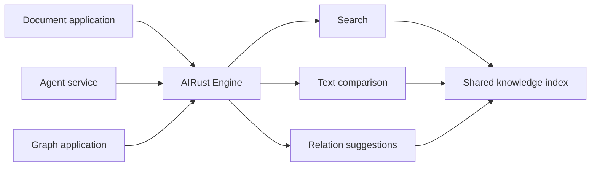

# AIRust architecture

The calling application owns its content, presentation, accounts, and storage. AIRust provides retrieval and comparison through a shared in-memory knowledge index.

The arrows represent possible library calls. No external application is integrated by this change. A calling application supplies its own storage, transport, and presentation after the engine contracts have been tested.

## Modules

| Module | Responsibility |
| --- | --- |
| `text` | Normalize Unicode, split words and numbers, and count terms. |
| `knowledge` | Represent generic entries and relation suggestions; retain the existing training collection. |
| `index` | Own entries, postings, and the central `Engine` operations. |
| `search` | Define BM25 parameters, TF-IDF retrieval, and search results. |
| `matching` | Compare character edits and token overlap. |
| `context` | Restrict eligible entries by ID and metadata. |
| `semantic` | Optional provider interface, validated vectors, model-space identity, and exact semantic retrieval. |
| `semantic::local` | Optional CPU E5 adapter using explicit model files and a dynamic native runtime. |

`Engine` is an alias for `KnowledgeIndex`. Search, comparison, and relation suggestions use the same source entries.

## Entries and updates

An entry has an application-owned `id`, searchable `text`, and optional JSON `metadata`. The original text and metadata remain available in results.

Derived data includes normalized text, term frequencies, and text length. Inverted postings map a term to entries that contain it. A separate normalized-text map tracks exact duplicate groups.

`upsert()` validates an entry before changing the index. An existing ID means replacement. It removes old postings and duplicate references before inserting the replacement. `remove()` removes those references along with the entry. Unchanged documents are not tokenized again.

Entries returned by `get()`, `entries()`, and results are immutable references. Callers must use index methods for changes. Rust prevents an index mutation while a result borrowing that index is still used.

JSON export stores source entries. Import rebuilds derived indexes and rejects duplicate IDs. This keeps saved data independent of internal indexing details.

## Search

The default `search()` mode is BM25. It scores matching terms using document frequency, term frequency, and document length. Repeating a query term does not repeatedly add the same BM25 contribution.

`SearchAlgorithm::Tfidf` uses term frequencies with smoothed inverse document frequency and cosine similarity. These are lexical vectors. They do not encode learned meanings or synonyms.

Both modes find candidate entries through shared postings. A bounded heap retains only the requested top results. Selection retains O(K) results for limit K; candidate IDs can still occupy O(M) memory for M candidates. A query without term overlap has no results. Scores are positive and finite. Equal scores use ascending entry IDs. Context filters restrict eligible entries while corpus statistics still describe the complete index.

The API exposes scores as evidence for ranking. BM25 scores are unbounded relevance values. TF-IDF cosine scores lie between zero and one. Neither is a calibrated probability.

## Optional embeddings

The optional `SemanticIndex` owns the existing lexical index and a vector side table. Source entries are stored once. Its lexical view is immutable; update methods validate and stage embeddings before updating both stores. It reuses `Context` and `TopK`. Provider batches receive borrowed original text and a query/document purpose. Cosine similarity and model-space validation are separate from BM25 and TF-IDF. See [SEMANTIC.md](SEMANTIC.md).

## Matching and duplicates

`compare()` returns normalized equality, character similarity, and token similarity. Character similarity is one minus normalized Levenshtein distance. Token similarity is the Jaccard index of unique tokens. An empty text has zero similarity, including to another empty text.

`find_matches()` uses a default character-similarity threshold of 0.8. Its bounded Unicode edit-distance calculation prunes candidates that cannot reach the requested threshold while retaining the same accepted matches as full comparison. `match_with_options()` selects exact comparison, fuzzy spelling similarity, or token overlap. `r#match()` is a Rust raw-identifier alias for `find_matches()`.

`duplicates()` groups entries with exactly equal normalized text. It does not delete or merge them. The caller can inspect source text and metadata before choosing an action.

Normalization applies NFKC, lowercase conversion, and collapsed whitespace. Accents and punctuation remain significant for exact comparison. This is not full Unicode case folding or language-specific stemming. Tokenization preserves Unicode letters, numbers, and combining marks; punctuation creates word boundaries.

## Context

A `Context` can restrict eligible IDs and compare top-level metadata fields. Multiple IDs form an allowed set. Multiple metadata conditions must all match. Metadata comparisons use exact JSON values.

Empty filters allow every entry. The filter does not append conversation history to a query.

The older `ContextAgent` retains its existing behavior: it appends formatted conversation history to a query before calling the wrapped agent. That can prevent an exact match. Use `Context` when the intended behavior is search scoping.

## Relation suggestions

`relate()` finds entries sharing terms with a source entry. A small English and German stopword list removes common function words. Candidate discovery uses the same postings as search.

Each suggestion contains source ID, target ID, `RelationKind::Related`, a Jaccard score, and shared terms. The source entry is excluded from its own targets. An unknown source ID is an error. Suggestions are computed on demand and are not stored as facts.

Opposite claims can share words. Hierarchy, prerequisites, causality, and contradictions need additional evidence. Cosine similarity from an embedding provider does not by itself classify those logical relationships.

## Compatibility adapters

`TfidfAgent` delegates its historical BM25 behavior to the common index and applies existing example weights. `MatchAgent` shares character-distance logic while retaining its historical exact-match whitespace policy. The existing `KnowledgeBase` reads training data rather than generic indexed entries.

The optional web vector functions retain their existing storage formats. They are lexical adapters, not a second semantic engine. The training table supports optional metadata so import provenance can survive a restart.

PDF extraction, HTTP, SQLite, crawling, and the dashboard are opt-in Cargo features. The default API is synchronous and operates in memory without network services.

## Operational limits

The index holds its complete source and derived data in memory. Candidate postings can be large for common terms. Fuzzy comparison remains sensitive to text length and requested thresholds. This version is not a measured capacity guarantee for millions of large documents.

The runnable benchmark compares a fixed workload through the historical agent API. Historical before-and-after results are in [CHANGES-0.1.8.md](CHANGES-0.1.8.md). Performance measurements must identify their corpus, query distribution, host, and build configuration.

The [roadmap](../ROADMAP.md) separates implemented optional embeddings from future hybrid fusion, graphs, context assembly, provenance, persistent derived indexes, HNSW, revisions, and broader quality evaluation.

Public method contracts are documented in [API.md](API.md). Source comments are intentionally absent; design and validation explanations live in these documents.
