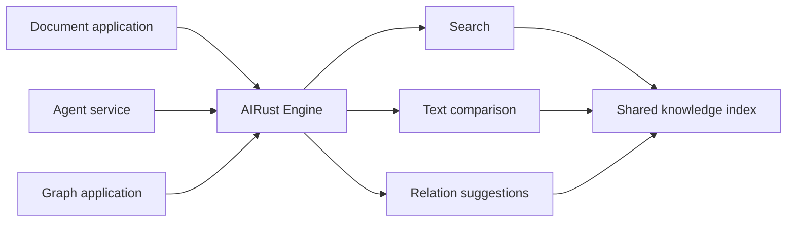

# AIRust architecture

The calling application owns its content, presentation, accounts, and storage. AIRust provides retrieval and comparison through a shared in-memory knowledge index.

The arrows represent possible library calls. No external application is integrated by this change. A calling application supplies its own storage, transport, and presentation after the engine contracts have been tested.

## Modules

| Module | Responsibility |
| --- | --- |
| `text_search` | Optional positional wrapper over shared Engine storage/ranking, configurable Unicode/German analysis and bounded phrase evidence. |
| `text` | Normalize Unicode, split words and numbers, and count terms. |
| `knowledge` | Represent generic entries and relation suggestions; retain the existing training collection. |
| `index` | Own entries, postings, and the central `Engine` operations. |
| `search` | Define BM25 parameters, TF-IDF retrieval, and search results. |
| `matching` | Compare character edits and token overlap. |
| `context` | Restrict eligible entries by ID and metadata. |
| `semantic` | Optional provider interface, validated vectors, model-space identity, and exact semantic retrieval. |
| `semantic::local` | Optional CPU E5 adapter using explicit model files and a dynamic native runtime. |
| `hybrid` | Optional weighted reciprocal-rank fusion using existing lexical and semantic results. |
| `reranking` | Optional provider-neutral rescoring of bounded authorized candidates without mutating retrieval state. |
| `reranking::local` | Optional verified multilingual cross-encoder using explicit local assets. |
| `local_runtime` | Private shared ONNX environment for local E5 and reranker sessions. |
| `graph` | Optional stable ID graph using petgraph, shared endpoint IDs, bounded queries, and iterative mixed-cycle analysis. |

`Engine` is an alias for `KnowledgeIndex`. Search, comparison, and relation suggestions use the same source entries.

## Entries and updates

An entry has an application-owned `id`, searchable `text`, and optional JSON `metadata`. The original text and metadata remain available in results.

Derived data includes normalized text, term frequencies, and text length. Inverted postings map a term to entries that contain it. A separate normalized-text map tracks exact duplicate groups.

`upsert()` validates an entry before changing the index. An existing ID means replacement. It removes old postings and duplicate references before inserting the replacement. `remove()` removes those references along with the entry. Unchanged documents are not tokenized again.

Entries returned by `get()`, `entries()`, and results are immutable references. Callers must use index methods for changes. Rust prevents an index mutation while a result borrowing that index is still used.

JSON export stores source entries. Import rebuilds derived indexes and rejects duplicate IDs. This keeps saved data independent of internal indexing details.

## Search

The default `search()` mode is BM25. It scores matching terms using document frequency, term frequency, and document length. Repeating a query term does not repeatedly add the same BM25 contribution.

`SearchAlgorithm::Tfidf` uses term frequencies with smoothed inverse document frequency and cosine similarity. These are lexical vectors. They do not encode learned meanings or synonyms.

Both modes find candidate entries through shared postings. A bounded heap retains only the requested top results. Selection retains O(K) results for limit K; candidate IDs can still occupy O(M) memory for M candidates. A query without term overlap has no results. Scores are positive and finite. Equal scores use ascending entry IDs. Context filters restrict eligible entries while corpus statistics still describe the complete index.

The API exposes scores as evidence for ranking. BM25 scores are unbounded relevance values. TF-IDF cosine scores lie between zero and one. Neither is a calibrated probability.

## Optional embeddings

The optional `SemanticIndex` owns the existing lexical index and a vector side table. Source entries are stored once. Its lexical view is immutable; update methods validate and stage embeddings before updating both stores. It reuses `Context` and `TopK`. Provider batches receive borrowed original text and a query/document purpose. Cosine similarity and model-space validation are separate from BM25 and TF-IDF. See [SEMANTIC.md](SEMANTIC.md).

The `hybrid` feature ranks each component through those existing APIs, then merges by borrowed entry ID. A temporary map retains at most two candidate lists and the shared heap keeps final top results. Component scores and ranks remain inspectable. Explicit offline fallback is distinguished from successful semantic participation. Model and vector integrity failures remain errors. See [HYBRID.md](HYBRID.md).

## Optional reranking

The optional reranking pipeline sits after retrieval and before final result/context selection. It borrows original candidates, captures each entry once, filters scope before its candidate cap, validates all selected inputs before inference, then scores bounded batches. It sorts finite model scores while retaining original component evidence and stable input-order ties. A provider-only fallback is explicit, discards partial scores and cannot bypass a score threshold. Local inference reuses FastEmbed and a shared process-wide runtime instead of creating a second transformer implementation. See [RERANKING.md](RERANKING.md).

## Matching and duplicates

`compare()` returns normalized equality, character similarity, and token similarity. Character similarity is one minus normalized Levenshtein distance. Token similarity is the Jaccard index of unique tokens. An empty text has zero similarity, including to another empty text.

`find_matches()` uses a default character-similarity threshold of 0.8. Its bounded Unicode edit-distance calculation prunes candidates that cannot reach the requested threshold while retaining the same accepted matches as full comparison. `match_with_options()` selects exact comparison, fuzzy spelling similarity, or token overlap. `r#match()` is a Rust raw-identifier alias for `find_matches()`.

`duplicates()` groups entries with exactly equal normalized text. It does not delete or merge them. The caller can inspect source text and metadata before choosing an action.

Normalization applies NFKC, lowercase conversion, and collapsed whitespace. Accents and punctuation remain significant for exact comparison. This is not full Unicode case folding or language-specific stemming. Tokenization preserves Unicode letters, numbers, and combining marks; punctuation creates word boundaries.

## Context

A `Context` can restrict eligible IDs and compare top-level metadata fields. Multiple IDs form an allowed set. Multiple metadata conditions must all match. Metadata comparisons use exact JSON values.

Empty filters allow every entry. The filter does not append conversation history to a query.

The older `ContextAgent` retains its existing behavior: it appends formatted conversation history to a query before calling the wrapped agent. That can prevent an exact match. Use `Context` when the intended behavior is search scoping.

## Relation suggestions

`relate()` finds entries sharing terms with a source entry. A small English and German stopword list removes common function words. Candidate discovery uses the same postings as search.

Each suggestion contains source ID, target ID, `RelationKind::Related`, a Jaccard score, and shared terms. The source entry is excluded from its own targets. An unknown source ID is an error. Suggestions are computed on demand and are not stored as facts.

Opposite claims can share words. Hierarchy, prerequisites, causality, and contradictions need additional evidence. Cosine similarity from an embedding provider does not by itself classify those logical relationships.

## Optional graph

The independent `KnowledgeGraph` stores only IDs and explicit relationships. It does not own knowledge entries or synchronize them automatically. petgraph provides stable adjacency storage; shared strings avoid repeated endpoint allocations. Bounded ordered traversals enforce generic direction, relation-type, and allowed-ID policies. Mixed cycle detection contracts undirected forest components and checks the directed quotient with iterative topological sorting. Existing lexical proposals do not automatically become graph facts.

## Compatibility adapters

`TfidfAgent` delegates its historical BM25 behavior to the common index and applies existing example weights. `MatchAgent` shares character-distance logic while retaining its historical exact-match whitespace policy. The existing `KnowledgeBase` reads training data rather than generic indexed entries.

The optional web vector functions retain their existing storage formats. They are lexical adapters, not a second semantic engine. The training table supports optional metadata so import provenance can survive a restart.

PDF extraction, HTTP, SQLite, crawling, and the dashboard are opt-in Cargo features. The default API is synchronous and operates in memory without network services.

## Operational limits

The index holds its complete source and derived data in memory. Candidate postings can be large for common terms. Fuzzy comparison remains sensitive to text length and requested thresholds. This version is not a measured capacity guarantee for millions of large documents.

The runnable benchmark compares a fixed workload through the historical agent API. Historical before-and-after results are in [CHANGES-0.1.8.md](CHANGES-0.1.8.md). Performance measurements must identify their corpus, query distribution, host, and build configuration.

The [roadmap](../ROADMAP.md) records implemented optional embeddings, hybrid fusion, graphs, and context assembly, and provenance, followed by separate persistent-cache, HNSW, revision, and quality stages.

Public method contracts are documented in [API.md](API.md). Source comments are intentionally absent; design and validation explanations live in these documents.

## Structured context selection

The optional `context_engine` module borrows the existing index, rankers and graph. It gives ranked source entries priority, intersects scopes, and adds bounded BFS neighbors without allowing missing or excluded entries to act as bridges. Text excerpts and metadata remain borrowed. Normalized duplicate content shares an excerpt while retaining distinct source references. Source-ID and text-byte budgets are separate; metadata and prompt serialization remain the application's responsibility. See [CONTEXT.md](CONTEXT.md).

## Source provenance sidecar

The independent `provenance` module owns reference definitions once and maps stable entry IDs to sorted reference-ID sets. It contains no knowledge text and performs no filesystem or network access. Versioned imports validate references and bindings; merges reject conflicts before changing state. With context assembly, results borrow source definitions for each selected entry. The caller keeps source bindings synchronized with its own committed content changes. Excerpt offsets are not converted to external document coordinates. See [PROVENANCE.md](PROVENANCE.md).

## Derived cache boundary

The optional cache serializes derived analysis and vectors, not authoritative source records. A validated load moves supplied originals into reconstructed posting/duplicate structures. Model, source and Unicode analysis recipes gate reuse. The existing atomic writer streams cache files with private permissions. See [CACHE.md](CACHE.md).

## Optional ANN topology

HNSW topology shares immutable vector buffers with the semantic index. The wrapper owns mutation so changed/deleted base IDs cannot silently retain stale answers. Exact re-scoring, changed-entry overlay and scope/small-index/pending-policy fallbacks keep behavior inspectable. Existing hybrid/context methods continue their exact path. Semantic cache format is preserved; ANN topology is rebuilt separately. See [ANN.md](ANN.md).

## Revision and history boundary

The independent versioning wrapper owns the existing lexical engine and revision heads. Private mutation prevents bypassing expected-version checks. Default tracking retains no old text; optional bounded committed snapshots permit restoration. Change metadata uses shared immutable storage. Versioned JSON is caller-owned history data, separate from portable entries and the derived cache. Database commits, semantic refresh and provenance validity remain application-owned. See [VERSIONING.md](VERSIONING.md).

## Quality and application boundaries

The quality module consumes ranked IDs and caller judgments; it requires no engine, model or transport. Integration harnesses are development tools, not runtime dependencies. The [cookbook](API-COOKBOOK.md) distinguishes alternative index owners from borrowed sidecars, and the [proposed DenkMaps upgrade](DENKMAPS-UPGRADE.md) preserves its existing SQLite authority and access rules. No application integration is performed by the library release.

## Advanced positional analysis

`TextIndex` privately uses `insert_analyzed` and `search_analyzed` inside the same Engine implementation. Its immutable analyzer builds terms and positional evidence before committing replacements. Context is checked before phrase evaluation; phrase/term constraints precede shared top-K. KMP matches required phrases in linear token-stream time per phrase and returns bounded original UTF-8 spans. The internal Engine is not exposed as an ordinary legacy analyzer or passed into old cache/vector wrappers. Original source records are owned once; positions are additional derived memory.

Storage adapters are optional and own original records, not automatic search-index synchronization. See [the storage contract](STORAGE.md).

The optional compact Retrieval API reuses existing ranking, scopes results and bounds complete JSON. See [the retrieval contract](RETRIEVAL.md).

Relevant excerpts are explicitly enabled through RetrievalOptions, preserve original UTF-8 positions and impose separate analysis/highlight limits. See [the excerpt contract](EXCERPTS.md).

The optional snapshot coordinator publishes search, vectors and source bindings together. Acquire one immutable view per request; its revision is a consistency token, not authorization or an external database transaction. See [the snapshot contract](SNAPSHOTS.md).

Optional retrieval evidence assessment distinguishes policy success, insufficient evidence and uncertainty. It evaluates delivered text and explicit score gates, not source truth or calibrated answer probability. See [assessment contract](ASSESSMENT.md).

The optional execution feature adds shared cooperative cancellation. Supported controlled APIs return typed interruption errors and preserve the dataset publication boundary. Blocking providers/lock waits are not forcibly interrupted. See [execution contract](EXECUTION.md).

Execution controls also support monotonic cooperative deadlines, saturating remaining budgets and parent limits that cannot be extended by a derived control. A late provider response is discarded; blocked work is not forcibly stopped. See [time-budget contract](EXECUTION.md).

Optional execution observers expose actual work phases and counts. Notifications contain no query text, use best-effort delivery, isolate callback panics and run outside publication locks. Results/revisions remain authoritative. See [progress contract](EXECUTION.md).

Reproducible opt-in synthetic scale/concurrency workloads have explicit count guards and correctness assertions. They measure lexical RAM/source snapshots, not universal capacity or production security. See [stress methodology](STRESS.md).

The optional shared-index feature shares immutable record/posting/duplicate payloads across clones, detaches changed buffers and preserves old readers. Default storage and wire formats remain unchanged. See [sharing contract](SHARED-INDEX.md).

Incremental updates retain unchanged term/positional analysis, update metadata in each projection and refresh coordinates whenever original text bytes change. Diagnostic preparation receipts distinguish rebuilt/reused analysis. See [incremental contract](INCREMENTAL.md).

Optional adaptive routing selects only explicitly registered sources, freezes analyzer selection during metadata-only preflight and preserves actual recipes/scopes. Source failures never trigger hidden retries. Route traces are separate diagnostics. See [routing contract](ADAPTIVE.md).

## Optional explicit feedback learning (0.2.23)

a bounded local feedback ledger and inspectable smoothed ranking adjustments. Enable `feedback` explicitly. See [API and limits](FEEDBACK.md).
