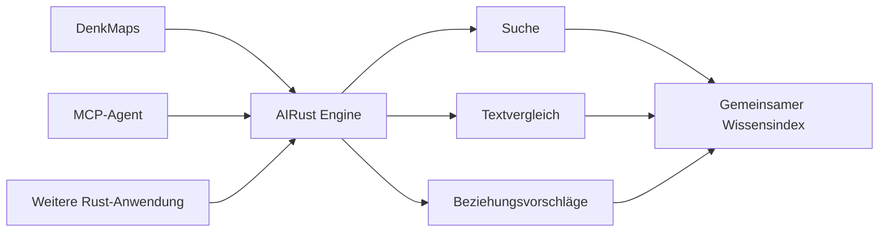

# Wie AIRust 0.1.8 aufgebaut ist

Die Anwendung besitzt ihre Daten. AIRust hilft beim Finden und Vergleichen. Die Darstellung, Benutzerkonten und dauerhafte Speicherung gehören zur Anwendung.

Die Pfeile zeigen mögliche Bibliotheksaufrufe. Sie bedeuten nicht, dass ein separates DenkMaps- oder MCP-Projekt bereits geändert wurde.

## Die Bausteine

| Modul | Aufgabe |
| --- | --- |
| `text` | Unicode normalisieren, Wörter und Zahlen zerlegen, Begriffe zählen |
| `knowledge` | `KnowledgeEntry` und `RelationSuggestion`; zusätzlich die bisherige `KnowledgeBase` |
| `index` | Einträge und Suchverweise verwalten; zentrale `Engine`-API |
| `search` | BM25-Parameter, TF-IDF-Suchmodus und Trefferformate |
| `matching` | Levenshtein-Abstand, Jaccard-Wert und Vergleichseinstellungen |
| `context` | Suche nach IDs oder Metadaten begrenzen |

`Engine` ist ein kurzer Name für `KnowledgeIndex`. Es gibt keinen zweiten getrennten Datenspeicher für die drei Aufgaben.

## Einträge und Änderungen

Ein Eintrag besteht aus `id`, `text` und optional `metadata`. Metadaten können beliebige JSON-Daten enthalten. Der Index verändert den ursprünglichen Text nicht.

Der Index speichert zusätzlich die normalisierte Schreibweise, die Häufigkeit jedes Begriffs und die Textlänge. Ein umgekehrter Index merkt sich, in welchen Einträgen ein Begriff vorkommt. Eine zweite Zuordnung sammelt Texte mit derselben normalisierten Schreibweise für die Duplikatprüfung.

`upsert()` prüft die Eingabe vor der Änderung. Eine leere ID oder ein leerer Text wird abgelehnt. Bei einer vorhandenen ID werden zuerst die alten Suchverweise entfernt und dann die neuen eingefügt. `remove()` entfernt auch Suchverweise und Duplikatzuordnungen. Unveränderte Einträge werden nicht erneut zerlegt.

`get()` und Treffer geben nur unveränderliche Referenzen heraus. Änderungen müssen deshalb durch die Indexmethoden laufen. Ein Treffer kann nicht gleichzeitig gehalten und sein Index verändert werden; Rust prüft diese Lebensdauerregel. JSON-Export speichert die Einträge, keine möglicherweise veralteten Suchverweise. Der Import lehnt doppelte IDs ab.

## Suche

`search(query, limit)` verwendet BM25. Das Verfahren bewertet gemeinsame Suchbegriffe, ihre Seltenheit und die Länge des Eintrags. Häufige Wiederholungen desselben Suchbegriffs erhöhen den BM25-Wert nicht künstlich.

`search_with_options()` erlaubt `SearchAlgorithm::Tfidf`. Hier werden Begriffshäufigkeiten mit einer geglätteten Seltenheitsgewichtung verbunden. Kosinusähnlichkeit vergleicht diese lexikalischen Vektoren. Das Ergebnis liegt zwischen null und eins. Diese Werte sind keine neuronalen Embeddings.

Beide Suchmodi verwenden dieselben Einträge und Suchverweise. Sie bewerten nur Einträge, die mindestens einen Suchbegriff enthalten. Bei einem Gleichstand entscheidet die ID in aufsteigender Reihenfolge. Die Ergebnisliste enthält nur positive, endliche Werte. `limit = 0` ergibt keine Treffer.

`SearchOptions::default()` liefert höchstens zehn Treffer. `Bm25Config::new(k1, b)` prüft die Parameter. `k1` muss positiv und endlich sein. `b` liegt zwischen null und eins. Die Vorgaben sind `k1 = 1.2` und `b = 0.75`.

## Vergleich und Duplikate

`compare(a, b)` liefert drei getrennte Hinweise: normalisierte Gleichheit, Zeichenähnlichkeit und Wortüberschneidung. Zeichenähnlichkeit basiert auf Levenshtein. Wortüberschneidung basiert auf Jaccard. Beide Maße liegen zwischen null und eins. Leere Texte erhalten null Ähnlichkeit.

`find_matches(text, limit)` sucht standardmäßig ab 0,8 Zeichenähnlichkeit. `match_with_options()` erlaubt `Exact`, `Fuzzy` oder `TokenOverlap` und prüft den Grenzwert. Auch `r#match()` ist verfügbar. Gleiche Rangwerte werden nach ID geordnet.

`duplicates()` sammelt exakt gleiche normalisierte Texte. Das ist keine automatische Zusammenführung. Die Anwendung kann die ursprünglichen Texte und Metadaten vergleichen, bevor sie etwas löscht.

NFKC vereinheitlicht kompatible Unicode-Schreibweisen. Kleinschreibung und zusammengefasste Leerzeichen folgen. Das ist keine vollständige Unicode-Fallfaltung und keine sprachspezifische Wortstammanalyse. Akzente und Satzzeichen werden beim exakten Vergleich nicht entfernt.

## Kontext

Ein `Context` kann die Suche auf bestimmte IDs begrenzen. Mehrere IDs werden als Auswahl zusammengefasst. Zusätzlich können mehrere Metadatenbedingungen gesetzt werden; diese müssen alle passen. Werte werden als exakte JSON-Werte verglichen. Die Metadaten müssen dafür ein Objekt sein.

Ein leerer Filter erlaubt alle Einträge. Die Rangberechnung verwendet weiterhin die Statistiken des vollständigen Index. Der Filter hängt keinen Gesprächsverlauf an die Suchanfrage an.

Das ältere `ContextAgent` bleibt als Adapter erhalten. Er hängt Gesprächspaare an den Fragetext an. Das kann exakte Treffer verhindern. Für einen gezielten Suchbereich sollte eine neue Anwendung `Context` verwenden.

## Beziehungen

`relate(id, limit)` verwendet die vorhandenen Begriffe eines Eintrags. Ein kleiner deutscher und englischer Stoppwortsatz entfernt allgemeine Wörter wie „und“ oder „the“. Kandidaten stammen aus dem gemeinsamen Suchindex.

Ein Vorschlag enthält Quell-ID, Ziel-ID, `RelationKind::Related`, einen Jaccard-Wert und die gemeinsamen Begriffe. Der Ausgangseintrag selbst erscheint nicht als Ziel. Eine unbekannte ID ergibt einen Fehler. Vorschläge werden nicht im Index gespeichert.

Wortüberschneidung kann keine logische Beziehung beweisen. Auch gegensätzliche Aussagen können dieselben Wörter enthalten. Für Voraussetzungen, Unterthemen oder Widersprüche braucht eine Anwendung zusätzliche Belege oder einen optionalen externen Anbieter.

## Aufwand und Grenzen

Die Suche zerlegt die Anfrage und sammelt Kandidaten über Suchverweise. BM25 verwendet bereits erfasste Längen und Begriffshäufigkeiten. Die Treffer werden zurzeit vollständig sortiert; bei M Kandidaten kostet das ungefähr M × log(M) Vergleiche. TF-IDF berechnet die Normen der Kandidaten mit den aktuellen Korpusstatistiken.

Fuzzy Matching prüft grundsätzlich den Bestand. Der klassische Levenshtein-Abstand kann bei langen Texten teuer sein. Der Index ersetzt keine spezialisierte Suche für Millionen langer Dokumente. Er läuft vollständig im Arbeitsspeicher. Es gibt in dieser Version keine Messung, die eine allgemeine Größen- oder Antwortzeitgarantie rechtfertigt.

Der Laufzeitvergleich unter `examples/benchmark.rs` verwendet die gemeinsame bisherige Agenten-API. Dadurch lässt sich derselbe kleine Fall vor und nach der Überarbeitung messen.

## Bisherige Integrationen

Die Trainings- und Agenten-API bleibt verfügbar. `TfidfAgent` delegiert BM25 an den neuen Index. `MatchAgent` verwendet dieselbe Levenshtein-Funktion. Seine historische exakte Vergleichsregel bleibt erhalten. Textzerlegung wird auch von den optionalen Vektorfunktionen gemeinsam verwendet.

Die alten Web-Vektorfunktionen und ihre SQLite-Schemata bleiben aus Kompatibilitätsgründen eigenständige optionale Adapter. Sie sind kein zweiter Kern und keine neuronale Datenbank. Sie wurden nicht vollständig auf ein neues Speicherformat umgestellt. Die Trainingsdatentabelle erhält beim Serverstart eine zusätzliche optionale Spalte für Metadaten. Diese Ergänzung erhält vorhandene Zeilen und macht Herkunftsdaten dauerhaft verfügbar.

PDF, HTTP, SQLite, Crawler und Bedienoberfläche werden nur über Cargo-Funktionen zugeschaltet. Es gibt weder eine zwingende LLM-Abhängigkeit noch eine eigene LLM-Engine.
