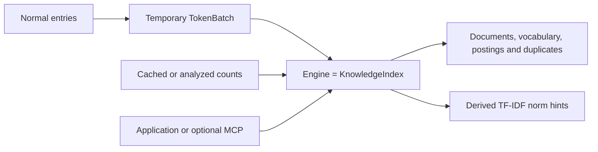

# Core performance and bounded retrieval

AIRust 0.4.4 reduces temporary allocation traffic during index construction. It keeps the construction/ranking design from 0.4.3 and the shared strings/TF-IDF reuse introduced in 0.4.2. Applications keep the same `Engine`, entries and search methods. There is no model to download or new default feature to enable.

## What is shared

Public `KnowledgeEntry` fields remain owned ID/text strings and optional metadata. The index privately shares immutable strings for vocabulary words, document-map/posting/duplicate-group IDs and identical normalized text. A vocabulary word is stored once across postings and document term maps. Original source text is preserved. Normal insertion groups a bounded sorted prefix of borrowed tokens, then streams the remaining tokens into the shared term map. It does not construct an intermediate owned-string token map.

This does not turn the whole index into one copy of the corpus. Source text, normalized text, tree nodes, counts and metadata still consume memory. Distinct normalized documents remain distinct. `shared-index` additionally shares complete immutable document/posting blocks between index clones; the default clone still copies containers while sharing their immutable strings. Later clone edits retain their existing copy-on-write behavior.

## Bounded construction and vocabulary lookup

A private TokenBatch value owns at most 1,024 borrowed token/count pairs. It sorts by word and merges repeated counts in place, preserving the number of original token occurrences separately. The completed pairs are consumed into the existing ordered per-entry term map. Remaining tokens stream through the original counter path, including terms already seen in the prefix. Original text, Unicode normalization and separators retain their existing behavior.

Reservation uses a bounded estimate of normalized text bytes. Empty token streams allocate no batch storage. A single token reserves one slot even when its text is very long. Multi-token storage can grow only to the fixed prefix bound. No scratch buffer is retained in KnowledgeIndex or between documents, so one unusual entry does not increase every later index clone. Tree construction, normalization and source storage still allocate. The measured Rust compiler can reuse the consumed pair allocation during collection; that is a standard-library implementation detail, not an AIRust API or correctness requirement. No unsafe memory conversion is used.

The byte estimate can reserve more slots than needed when an entry contains only a few very long words. Such entries can request more cumulative working bytes than 0.4.3 despite making fewer allocation calls. The temporary buffer remains bounded to 1,024 pairs and completed live storage stays unchanged in the measured cases. See the authored [allocation distributions](measurements/0.4.4/heap-edges.json) alongside the real-document profile; allocation count, allocated bytes and peak memory describe different costs.

KnowledgeIndex remains the single owner of lexical state. TokenBatch only prepares counts; every insertion still reaches the same prepared-insertion path and existing vocabulary/duplicate/statistics maintenance. Cache restoration and advanced analyzers supply their already-prepared counts to that path. No second index, global mutable pool, public option or required dependency is introduced.

`Engine` is a public alias for `KnowledgeIndex`, not another index wrapper. The private value types encapsulate preparation and ranking work; the authoritative state stays in one place.

The global vocabulary dictionary uses Rust's default randomly seeded `HashMap`. AIRust does not install a faster unprotected custom hasher. Entries, postings IDs, per-entry term order, duplicate groups and stable score/ID tie order retain their ordered structures. The global dictionary is used for lookup, not to enumerate results or serialized data. Hash seeds may affect costs/layout, not the ranking contract. See [Rust's standard map contract](https://doc.rust-lang.org/std/collections/struct.HashMap.html).

## Query preparation and winner explanations (since 0.4.3)

Known query words are prepared in their original sorted order. BM25's corpus-frequency logarithm is calculated once for each word, and document-length normalization once for each candidate. Score multiplication/division and sorted contribution order remain the same, including the existing overflow-resistant branch for large `k1`. Repeated query words retain the previous BM25 behavior. Unknown words produce no candidate/statistic entry.

In 0.4.3–0.4.9, candidate collection used an ordered ID set proportional to the union of postings. Starting with 0.4.10, smaller queries use the ordered merge described below; the wider-query fallback retains the ordered set. The top-K heap still retains only borrowed documents and scores. Only selected winners receive owned matched-term strings. Asking for every result still pays for every returned explanation. No result text is cut or omitted by this optimization.

Controlled calls check cancellation/deadlines inside long scoring and explanation loops as well as the existing phases. Selection, scopes, final ordering and progress completion retain their existing contracts. The separate BM25 oracle exercises extreme valid parameters and compares exact score bits; term batching is checked on both sides of the boundary and on long Unicode streams.

## TF-IDF reuse (since 0.4.2)

BM25 follows its existing path and creates no TF-IDF norm hints. A nonempty TF-IDF candidate set initializes a small shared hint store. Each visited candidate's complete document norm is calculated using the unchanged sorted-term formula. Later queries reuse that value. The query vector and candidate ranking still depend on the current query.

The hint store contains at most one norm per visited indexed document. It is lazy and may eventually cover the whole index. It adds memory rather than providing a zero-cost speedup. There is no persistent file or separate configuration: hints are derived work and never become authoritative knowledge.

Text edits, insertions, successful removals and `clear()` invalidate hints for the changed index. Any document-frequency change can affect every TF-IDF norm, so a local edit deliberately clears that index's complete store. Metadata-only updates preserve norms; failed updates or removal of an unknown ID leave valid hints intact. An index clone may share already-initialized hints while statistics match. Changing the clone invalidates only its derived store, leaving retained readers correct.

Queries use nonblocking read/write attempts. If another thread holds the hint lock, or a previous panic poisoned it, the query computes the exact value instead. It never waits for that hint lock. Simultaneous first queries may repeat a calculation; this favors predictable progress over forcing all readers to wait.

With `execution`, a cold norm calculation checks cancellation/deadlines within the term loop and before storing the completed value. A partial sum is never cached. Existing per-candidate and operation checkpoints remain. Cancellation stays cooperative, not a hard real-time or process-memory guarantee.

## Use the existing APIs

Keep one `Engine` alive across requests when possible. `search()` uses BM25; `search_with_options()` selects `SearchAlgorithm::Tfidf`. No warm-up call is required. Use `upsert()` and `remove()` for changes. Result entries still borrow the index. JSON serialization retains original records in deterministic ID order.

The 0.4.3 and 0.4.4 cache files cross-load through the public cache API. Their analysis/metadata payloads agree after the expected producer label. The label includes the crate version, so whole-file checksums differ. The private TF-IDF hints are not serialized. Knowledge JSON, document revisions, source fingerprints and reserved descriptors keep their existing formats.

MCP uses this core automatically. It remains optional and in the same crate. Its [response schemas](MCP.md#response-schemas) are independent of the internal memory layout. Default core/MCP normal dependency checks exclude the test validator, heap profiler, HTTP, SQLite and native model packages.

## Measured scope and remaining costs

See [the release report](CHANGES-0.4.4.md) and [machine-readable measurements](measurements/0.4.4/). Separate programs measure ordinary release calls, server process RSS and allocator-instrumented index heap. These metrics describe different boundaries and must not be treated as interchangeable.

Repeated TF-IDF queries over stable data are the intended beneficiary. A first query still performs uncached calculations. Frequent text edits discard that work; lock contention can repeat it. Small records can pay additional reference-count/tree overhead. BM25 uses query-local preparation rather than a persistent norm store; matching does not gain TF-IDF reuse. The disk-backed index and optional model algorithms have their own implementations. A lower measured index heap is not a hard process-RAM ceiling or a guarantee for every corpus.

Exact score-bit/order comparisons cover fixed real-text probes, updates/deletes, retained views and cache interoperability. They establish compatibility for those cases, not human relevance quality. The unchanged PDF backend is tested separately; this release does not re-extract the original PDFs or add OCR. No DenkMaps code or database is integrated.

After deletions, an empty vocabulary releases its hash allocation. A large dictionary is compacted when its word count falls below a quarter of the retained capacity; a separate high-water value avoids relying on deleted-slot bookkeeping. Small tables keep limited headroom. This adds an occasional rehash cost to deletion, can temporarily hold old and replacement tables, and does not alter retained reader contents. The dictionary, including this capacity hint, remains derived internal state and is not serialized.

## Query working allocations in 0.4.8

`text::term_frequencies` retains one owned key per distinct normalized token. After the first repeated token is observed, later repeats update the existing count through a borrowed lookup, avoiding temporary duplicate token strings. The first duplicate still creates one temporary key; an entirely unique input keeps the existing single entry-lookup path. NFKC/lower normalization, counts, term ordering and all scorer arithmetic remain unchanged. Once reuse is enabled, a new term needs an additional lookup, so mixed distributions can have a different latency tradeoff.

The optional `LexicalCoverageSource` reuses invariants of the existing built-in Engine: prepared question terms are unique, and each returned matched term occurs once in that effective question. Counts no longer require a new query set or a matched-term set per candidate. Original scores, component diagnostics, stable ordering, recipes and source positions remain. This optimization does not apply those assumptions to custom sources. See [coverage API](LEXICAL-COVERAGE.md) and [executed measurements](CHANGES-0.4.8.md).

## Complete retrieval and bounded serialization in 0.4.9

Legacy excerpt analysis uses direct lowercase ASCII tokenization when the complete input is ASCII. The normalized-byte budget is checked before collecting tokens, and token limits remain enforced. Original byte spans are unchanged. Mixed text still uses grapheme normalization and source mapping; its ASCII graphemes avoid unnecessary Unicode normalization. Compatibility expansions, combining marks and CRLF retain their existing rules. Advanced TextAnalyzer behavior is unchanged.

Size-only candidate, metadata and MCP guards share the bounded serializer with retained JSON output. A counting sink discards encoded bytes instead of keeping a temporary JSON buffer. Counting includes quotes, escapes and UTF-8 bytes, and stops on the same budget boundary. Serialization errors still fail explicitly. Actual responses and descriptors are still encoded and stored when needed. These internal helpers are not a new public API, cache or storage format. No option, dependency or default feature is added. Less working allocation is not automatically lower resident RAM or faster construction. Read the [measurements, regressions and limits](CHANGES-0.4.9.md).

## Index normalization and ordered candidates in 0.4.10

`text::normalize` takes a direct path only when the complete source is ASCII. ASCII A–Z are lowercased and the same whitespace characters collapse to one space, including vertical tab. Leading/trailing whitespace disappears as before. Controls that are not Unicode whitespace remain. Non-ASCII input retains the full NFKC/lowercase/NFKC path. Source entries and all persistent index structures remain.

Queries with at most 32 known distinct terms merge sorted postings using a small private min-heap. Duplicate IDs are skipped into a sorted vector borrowing the existing Arc key objects, with no cloned identifiers. The heap is bounded to 32 cursors; it does not retain entry text or rebuild the index. Wider known-term queries use the prior BTreeSet route. Unknown/repeated terms do not inflate the merge width. The query descriptor retains one additional postings reference per known term. The vector can reserve spare capacity; allocation counts and bytes have different meanings.

Each posting occurrence, including duplicates, still reaches a cancellation/deadline checkpoint. Collection visits and final unique counts remain observable. Scoring stays in original sorted ID order and original sorted term order, with the same arithmetic, context checks, top-K ties and winner explanations. The count/shape of timing-dependent progress notifications is not promised. No dependency, public option, cache or storage format is added. See [construction, allocation and MCP measurements with limits](CHANGES-0.4.10.md).

## TF-IDF and broad queries in 0.4.11

The transient norm-hint dictionary uses Rust's default randomly seeded HashMap instead of BTreeMap. The dictionary is used only for lookup, never to enumerate ranking contributions or exports. Complete norms are published after checkpoints. Metadata-only updates retain hints; lexical/corpus changes invalidate them. Busy or poisoned locks still fall back to exact computation without blocking. The table can allocate/reallocate and reserve more or fewer bytes; it is not an unconditional RAM optimization. BM25/unknown queries still avoid allocating the norm cache.

For more than 32 known query terms, when the query exceeds twice a document's distinct word count, scoring scans its sorted words and binary-searches the sorted prepared query. Other cases keep query-word lookups. Both routes accumulate matching terms in the same lexical order and keep exact arithmetic. Each 128 inspected terms reaches a checkpoint. The wider candidate BTreeSet now borrows existing Arc keys instead of wide string slices, preserving sorted unique IDs. No second index, dependency, public flag or storage migration is added. See [initial/warm timings, scratch allocations and retained hint memory](CHANGES-0.4.11.md).

## Cold TF-IDF hints in 0.4.12

The norm cache stores one machine-word key identifying an ID allocation already owned by this KnowledgeIndex. On a 64-bit build this replaces a two-word Arc string key and removes extra ID-reference count updates and string hashing. The standard randomly seeded HashMap remains; there is no custom unprotected hasher. The integer is never dereferenced, serialized, used as a public ID or accepted from a caller. Public identifiers and tie ordering remain original strings.

Unchanged clones retain the ID allocations for their shared valid hint cache. Metadata-only edits retain the same ID key; text/corpus edits, removal and clear discard the changing view's hints before its next query. Retained views keep their own valid data. Loading or rebuilding creates a fresh empty cache. Existing complete-value publication, nonblocking lock/poison fallback, cooperative checkpoints and exact norm arithmetic remain. No per-document field, eager corpus-sized allocation, dependency, public setting or storage migration is added. BM25 and unknown-word queries still do not allocate norm hints.

Measure retained hint bytes after dropping results separately from allocation traffic, warm calls and whole-process RSS. Reduced hint storage does not imply the same reduction in total application memory. See [all cold/warm/RAM results and limits](CHANGES-0.4.12.md).
