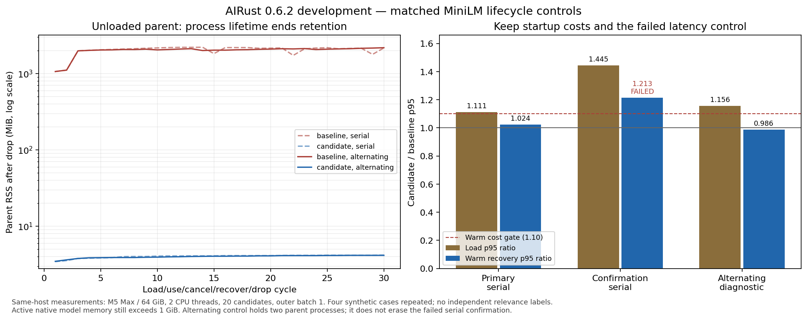

# Native model lifecycle: AIRust 0.6.2 development

The explicit verified-file `ProcessReranker` stabilizes **unloaded parent RSS** in three matched thirty-cycle cohorts. The old direct constructor still fails its growth budget. The declared maximum 10% warm p95 overhead is **not established repeatedly**: one serial confirmation fails. Both that failure and the rejected memory-worker prototype remain in the evidence. This is an unreleased opt-in operating mode, not a new publication, general speed guarantee or actual 1-GiB-device certification.

## Scope and identities

Measurements ran on **Apple M5 Max / 64 GiB / macOS 27.0.1 ARM64**, with Rust 1.98.0 release builds, thin LTO, one codegen unit, two ONNX CPU threads, twenty candidates, outer batch one and the unchanged 512-token pair recipe. The baseline is the **byte-identical published 0.6.1 scorer implementation**, exercised inside the same cohort binary as the candidate. `src/reranking/local.rs` SHA-256 is `52d5645e4f388c8e83659776a431d42c7547deba096c6b04a20c58c58b8d6ad5`; the legacy runtime module is unchanged too. These are not timings assigned to a separately compiled 0.6.1 executable.

The existing MiniLM weights are 470883696 bytes, SHA-256 `3e9a03ed1e966f7c5288dd4230e3d6a9bf5e3a170a06f1f4241c5bca12c6487c`. Model/tokenizer identities remain in [the pinned manifest](../../models/mmarco-minilm-v2.json). The existing ONNX Runtime 1.32.0 CPU library SHA-256 is `fa585fabbea65b823b9a8f7e27d46aee3989d1be7e36b528203d3a1fd613aae7`. No model or runtime was downloaded, no global allocator/environment setting adopted and no model service started.

The public [synthetic resource fixture](../../../tests/fixtures/native-lifecycle-v1.json), SHA-256 `fd478f054ba5a8ec673138c544a4e77c2ff897b5c4a8688ae5f27dde7918085f`, has four authored short/Unicode/mixed/long cases with twenty candidates each. It is separate from the frozen 150 reference-v1 questions and from private exposed conversation replays. Repeating it does not produce independent questions or relevance judgments. Timed native cohorts ran after builds and without simultaneous compiler/Miri/fuzz work. Startup uses already existing assets and is not a whole-machine cold-cache measurement.

## Reproduction and rejected allocation changes

The first control used four private exposed conversation prefixes, not independently reviewed customer traffic. Thirty load/use/cancel/deadline/recovery/drop cycles completed functionally, but the frozen 64-MiB post-warm RSS-range budget failed: **549.078 MiB**. Final parent RSS after drop was **2360.938 MiB**. Raw questions and source passage IDs remain private; the public export includes numeric resource/control observations only.

Three twelve-cycle ablations also failed:

| Native allocation experiment | Post-warm after-drop range MiB | Growth gate |
| --- | ---: | --- |
| Device-allocated initializers | 356.875 | Failed |
| Disabled CPU arena | 413.500 | Failed |
| Both changes | 410.391 | Failed |

All observed top-six IDs/order/raw score bits matched the corresponding baseline cycles. These shorter ablations are rejection evidence, not completed thirty-cycle positive gates. The shared early policy template still says thirty while each actual command/report says twelve; the export uses observed cycle counts. Patches, binaries, logs and raw samples are preserved. No allocation-policy patch was adopted.

`vmmap` reports large retained free/fragmented malloc regions after model values have dropped. Final malloc-zone accounting is about 20.6 MiB live allocation versus roughly 681 MiB fragmentation, alongside other resident regions. `leaks` reports zero unreachable allocations but warns that process inspection is restricted. These observations support native/system allocator retention and fragmentation; they do not exclude every leak or identify one exact internal ONNX allocation site. Changing ONNX allocation options did not resolve the observed growth. The process boundary ends the native heap's lifetime without unsafe allocator hooks. [ONNX memory controls](https://onnxruntime.ai/docs/get-started/with-c.html) and [official session-option definitions](https://github.com/microsoft/onnxruntime/blob/main/include/onnxruntime/core/session/onnxruntime_session_options_config_keys.h) describe the upstream controls; the local failed experiments govern the result here.

## Matched thirty-cycle resource controls

Each cycle loads, scores, cancels after one actual native batch, rejects an expired deadline without another native call, recovers with identical scores, drops and checks private-copy cleanup. After drop there must be no surviving model child. Warmup is the first two cycles; the budget is `max(parent RSS) - min(parent RSS)` over the remaining dropped observations, at most 64 MiB. It is a finite observed range, not an asymptotic leak slope or OS-enforced RAM quota.

| Cohort / operating mode | Post-warm range MiB | Final parent after drop MiB | Sampled active tree peak MiB | Growth gate |
| --- | ---: | ---: | ---: | --- |
| Primary: direct memory | 213.297 | 2082.906 | 2201.922 | Failed |
| Primary: rejected memory worker | 0.422 | 4.141 | 1619.422 | Passed, latency failed |
| Primary: direct file snapshot | 679.750 | 1887.438 | 1900.859 | Failed |
| Primary: selected file worker | 0.328 | 4.141 | 1311.562 | Passed |
| Serial confirmation: direct memory | 482.656 | 2167.563 | 2237.188 | Failed |
| Serial confirmation: selected file worker | 0.406 | 4.188 | 1284.922 | Passed |
| Alternating diagnostic: direct memory | 196.734 | 2182.813 | 2182.828 | Failed |
| Alternating diagnostic: selected file worker | 0.375 | 4.156 | 1254.125 | Passed |

The small parent is the lifecycle test process with no knowledge index/server/LLM loaded. Real applications retain their own data. Active model memory still exceeds 1 GiB. Tree RSS sums may double-count shared pages; they do not measure unique physical memory, kernel file cache, whole-system or GPU memory. Raw `wait4` maximum RSS has its own column and is not relabeled as a sampled tree sum. The alternating controller holds both parent processes resident but allows only one load/inference at a time; its combined two-tree peak was 3505438720 bytes. This differs from the serial pressure conditions and is stated before that run.

All sixty baseline/candidate cycles in each selected pair preserve all twenty result IDs, order and f64 score bits: **600 compared result positions per pair**, 1800 across the three selected comparisons. These repeat four synthetic cases; they are not 1800 distinct questions. The broader primary memory/file comparisons preserve their corresponding bits as well. The original eight-cycle mixed-worker smoke remains separate and passed 0.156 MiB growth; its memory-backed mode is no longer a supported public constructor.

## Request costs and the failed confirmation

Percentiles use the repository's existing nearest-rank function: sorted sample at `ceil(n*p)-1`. Each cell uses all thirty observations; slow cycles are never removed. The primary pre-run policy named p95 but omitted its estimator. Analysis reused the existing `scripts/run_reference_evaluation.py` estimator; later policies explicitly freeze it. That original protocol-detail omission remains documented.

| Selected file worker versus direct memory | Baseline / worker load p95 ms | Baseline / worker first p95 ms | Baseline / worker recovery p95 ms | Recovery ratio | Maximum 1.10 gate |
| --- | ---: | ---: | ---: | ---: | --- |
| Primary serial | 2175.471 / 2416.046 | 470.162 / 481.130 | 475.292 / 486.583 | 1.024 | Passed |
| Reversed serial confirmation | 2382.544 / 3442.998 | 495.433 / 572.892 | 493.898 / 599.252 | 1.213 | **Failed** |
| Alternating diagnostic | 2239.580 / 2589.639 | 481.439 / 475.011 | 480.544 / 473.757 | 0.986 | Passed for this scope |

The failed serial worker has a cluster of slow cycles, but no captured evidence assigns a specific external cause. The alternating run was frozen after observing that failure, alternates which backend runs first each cycle and retains both parents. It diagnoses variability; it neither erases the failure nor proves universally negligible IPC/load overhead. Loading was slower at p95 in all three selected comparisons.

The rejected memory-backed worker had warm recovery p95 **583.039 ms versus 475.292 ms**, ratio **1.227**, failing the declared 1.10 gate despite stable unloaded-parent RSS. Its constructor was removed from the new public API. Comparing verified file loading on both sides in the primary cohort gives 486.583 versus 481.422 ms, ratio 1.011. All five comparisons, including overlap, remain exported. There are **309 slower paired observations across load/first/recovery metrics**, including overlapping comparisons; this is not a unique-question count.

First/recovery timing covers the complete library rerank over the supplied twenty candidates, including IPC and native scoring. Loading includes worker startup, verified copying/checking and session construction. Lexical retrieval, embeddings, HTTP/MCP, an answer LLM and external services are not part of these timings.

## Raw samples and reproducible source

There are **314 actual cycles across thirteen workers/controls**: initial reproduction, three ablations, initial smoke, primary four-worker cohort, serial confirmation and alternating pair. Do not add an eight-cycle smoke or a twelve-cycle ablation to make a positive thirty-cycle run. Every failure remains separate. The [Git-only evidence manifest](evidence.json) records source/model/runtime/workload/method/binary hashes, original policies and exact source-preservation scope. Detailed measurement JSON is intentionally excluded from crates; the CSV, figure, methods and checksums are packaged.

- [Workers and all growth failures](workers.csv), [every event](events.csv), [latency samples](latency-samples.csv).
- [All comparisons](comparisons.csv), [every slower observation](slower-samples.csv), [public score bits](score-signatures.csv).
- [Alternating sampled RSS](alternating-rss-samples.csv), [binary/report/method identities](identities.csv).
- [SHA256SUMS](SHA256SUMS), [plot source](plot.py), [SVG figure](lifecycle.svg).

The public [primary prototype patch](paired-prototype-from-v0.6.1.patch) applies to exact tag v0.6.1. An isolated scratch application reproduces all **86 original executable-source input hashes** from the frozen pre-run receipt. Compile-support guide text is separately identified; no original pre-run guide-byte identity is invented. The [initializer](trial-device-initializers.patch), [CPU arena](trial-cpu-no-arena.patch) and [combined](trial-combined-allocation.patch) patches also apply to the original scorer. They are archival rejected inputs, not shipped runtime changes. The [alternating method](alternating-method.py.txt) is byte-identical to the executed controller; restore it at the recorded lab path with the matching binary/assets to reproduce its original layout. Its temporary/output paths are task-owned.

For the supported API, build/run the commands in [process ownership](../../LOCAL-MODEL-PROCESSES.md). The public [serial controller](../../../scripts/benchmark_model_lifecycle.py) refuses existing output directories, bounds time/input/process-count/RSS observations and records failures. Use the same source/weights/runtime/fixture/thread/batch settings. After the alternating run, subsequent changes are test/documentation and benchmark-handshake cleanup only; measurement reuse and final-source controls are recorded in [validation](../../validation-0.6.2/README.md), rather than assigning old samples to a new binary.

## Remaining limits

The direct constructors retain the measured allocator behavior. The process adapter implements the available pinned MiniLM reranker only; actual E5 inference assets were unavailable. Windows/Intel native execution, actual low-RAM devices, hard CPU/RAM quotas, unique system/GPU accounting and immediate cancellation inside native calls remain unestablished. Trusted workers must obey the no-descendant-pipe contract; this is not a security sandbox. Private copies cost at least 470883696 bytes per worker and can remain after abrupt application termination. No automatic retry/reload or global allocator policy is added.

Native ONNX and OS subprocess execution stay outside Miri; pure protocol/input bounds and actual native subprocess controls are separate. The finite shared-protocol fuzzer does not load random native models. The fifty independently reviewed question gate remains **0/50**, and independent onboarding/reproduction is open. Stable model ownership and passing engineering checks do not close those gates or the failed repeated latency-cost criterion.

## Additional repeat on commit 9e792bc (2026-11-26)

After the review fixes, the serial confirmation was repeated with the unchanged public controller on commit `9e792bc` (process transport identical to the measured implementation except that a rejected request no longer consumes the worker sequence ID). Two pairs ran in opposite order: A = direct memory baseline then verified-file worker, B = worker then baseline, thirty cycles each, same synthetic fixture, weights, runtime and two threads. The policy was frozen before execution. Data: [repeat-2026-11-26](repeat-2026-11-26/) (per-cycle CSV, sanitized reports, policy, analysis, checksums).

| Pair | Baseline / worker load p95 ms | Baseline / worker first p95 ms | Baseline / worker recovery p95 ms | Recovery ratio | Maximum 1.10 gate |
| --- | --- | --- | --- | --- | --- |
| A (baseline first) | 4218.834 / 2444.046 | 475.007 / 479.361 | 484.641 / 477.872 | 0.986 | Passed |
| B (worker first) | 2289.847 / 2431.282 | 481.653 / 482.282 | 485.187 / 485.336 | 1.000 | Passed |

| Run | Post-warm parent range MiB | Final parent after drop MiB | Sampled peak MiB | Growth gate |
| --- | --- | --- | --- | --- |
| A baseline (direct memory) | 208.500 | 2131.891 | 2275.438 | Failed |
| A worker | 0.328 | 4.188 | 1212.375 | Passed |
| B worker | 0.281 | 4.203 | 1211.922 | Passed |
| B baseline (direct memory) | 219.094 | 2128.203 | 2223.359 | Failed |

Both repeats pass the recovery-cost gate and both worker runs pass the memory gate; both direct baselines fail their growth budget again, as before. Baseline load p95 in pair A contains a slow-cycle cluster (median 2108.761 ms), so the load ratio of pair A (0.579) is not a load-time advantage of the worker; pair B shows the worker loading 6 % slower at p95. These two passes are additional evidence, not a replacement: the original serial confirmation remains **failed at 1.213**, and the declared criterion "established repeatedly" is now met by three of four serial-style comparisons, not by all. A separate steady-state measurement ([ipc-overhead-0.6.2](../ipc-overhead-0.6.2/README.md)) shows a median process-boundary cost of about 2 ms per twenty-call rerank and that host disturbances alone can push the unchanged baseline binary past the 1.10 p95 gate.

## Eight-pair unattended repeat on commit 9e792bc (2026-11-26, 21:29-21:55 UTC)

The rules were frozen before the run in the [policy](quiet-night-2026-11-26/policy.json). The run used the same binary (`4d4e4aaf…`) and the same controller as the evening repeat. There were eight serial pairs of 30 cycles each. Odd pairs ran baseline first, even pairs ran the worker first. The decision rule stated that "not reproduced on a quiet host" may only be written if all eight pairs pass 1.10.

The user was away, but the host was **not** quiet:

- The maintenance session ran about 5 s of Python unit tests during P1.
- The Claude Code session restarted at 21:32:47 UTC, between P1 and P2.
- Background OS activity was not instrumented.

All of this is recorded in [disturbances.txt](quiet-night-2026-11-26/disturbances.txt).

| Pair (order) | Baseline / worker recovery p95 ms | Recovery ratio | 1.10 gate | Baseline / worker load p95 ms | Worker post-warm range MiB |
| --- | --- | --- | --- | --- | --- |
| P1 (baseline first) | 482.2 / 563.6 | 1.169 | **Failed** | 2189.1 / 3290.1 | 0.266 |
| P2 (worker first) | 826.8 / 1341.1 | 1.622 | **Failed** | 4268.3 / 5304.9 | 0.266 |
| P3 (baseline first) | 484.0 / 467.0 | 0.965 | Passed | 2178.7 / 2280.3 | 0.297 |
| P4 (worker first) | 1039.9 / 1042.3 | 1.002 | Passed | 3684.0 / 3992.3 | 0.266 |
| P5 (baseline first) | 470.5 / 478.5 | 1.017 | Passed | 2160.6 / 2332.0 | 0.281 |
| P6 (worker first) | 471.9 / 464.2 | 0.984 | Passed | 2142.4 / 2254.3 | 0.219 |
| P7 (baseline first) | 474.2 / 474.3 | 1.000 | Passed | 2118.8 / 2415.7 | 0.250 |
| P8 (worker first) | 476.4 / 1198.7 | 2.516 | **Failed** | 2212.1 / 5547.1 | 0.281 |

**Result under the frozen rule:**

- The warm-recovery cost failure is **reproduced in 3 of 8 pairs**. It is not refuted, and "not reproduced" is not stated.
- All eight worker runs pass the memory-growth gate, with post-warm parent ranges of 0.219 to 0.297 MiB.
- All eight direct baselines fail their growth budget again, with ranges of 198 to 603 MiB.
- Worker load p95 is higher than the baseline in every pair (ratio 1.047 to 2.508). No load-time advantage follows from this.

**Observations, not measured causes:**

- In P2 and P4 the baseline runs are also slow (recovery p95 827 and 1040 ms, against about 475 ms in the other baselines). This points to host-wide slowdowns that affected both modes.
- In P8 only the worker run is slow. Its baseline is normal, so P8 is not explained by a shared slowdown.
- The pairs in which both runs look undisturbed (P3, P5, P6, P7) range from 0.965 to 1.017.

None of this removes a failure. Across the original confirmation, the evening repeat and this run, the 1.10 recovery gate has now failed in 4 of 11 serial pair comparisons. The worker's recovery tail on this host is therefore not established as within 10 %. Per-cycle data are in [cycles.csv](quiet-night-2026-11-26/cycles.csv), together with path-normalized reports, the run script, the analysis, the export and the [checksums](quiet-night-2026-11-26/SHA256SUMS).

**Foreign load during all 2026-11-26 runs.** A later process check found an unrelated project's Miri test process. It belonged to another Claude Code session, ran at about 96 % of one core, and had been started at 2026-11-26 00:17:49 UTC ([observation](quiet-night-2026-11-26/foreign-load-observed.txt)). It was therefore active during both the evening repeat and this eight-pair run. The run was "unattended", but the host was loaded. The effect of this load was not quantified, and no pass or failure above is re-labelled because of it. The original 1.213 run on 2026-11-25 predates this process.
