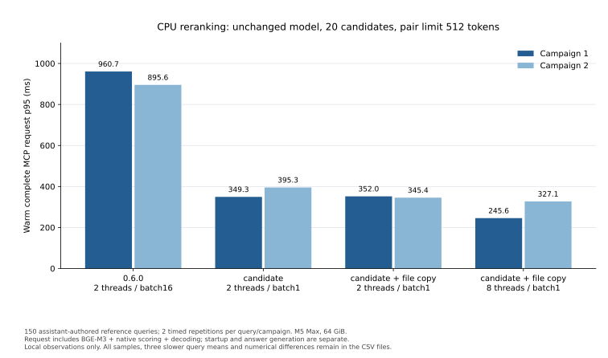
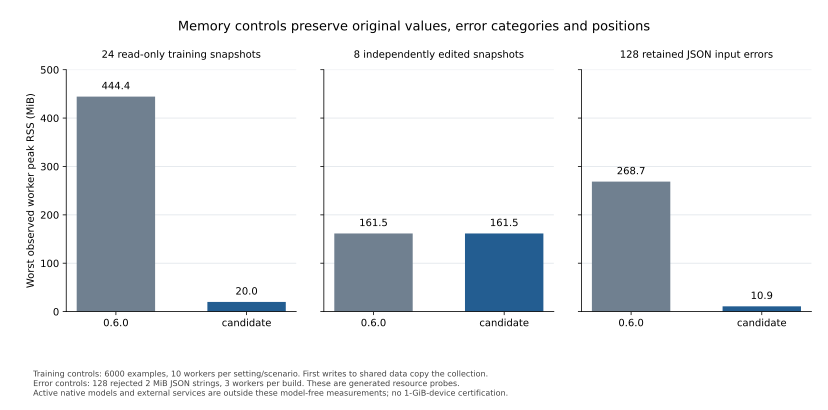
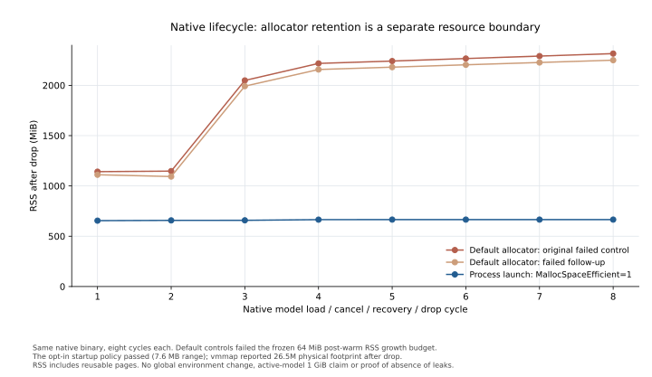

# Local answer pilot and bounded CPU reranking investigation

Status: local answers, native exploration, 150-query regression controls, complete-MCP comparisons and resource controls are complete. The public numeric exports below retain their original binaries, observations and regressions. A separate [final-source confirmation](../configuration-0.6.1-final/README.md) finished at 2026-11-25 07:16 UTC after full fuzz completion; it does not replace or relabel this earlier timing binary, which predates the error-only hardening. Candidate validation is recorded [separately](../../validation-0.6.1/README.md). No independent quality/adoption gate is passed.

## Frozen inputs and honest origin

The baseline is published AIRust 0.6.0 source `8c098f15a39f6085f748c56ac52e5737abdff423`, independently rebuilt with `pilot,local-reranking`, release profile and the retained lock. Binary SHA-256: `45abd1eef5cae133762514f7ecdf61c133f22f3ff73d73170348c307f9b665ad`.

Eighteen selected documents from that exact source produce 729 immutable passages. Corpus size is 240718 bytes; workspace file SHA-256 `7e09899cbd87d6d9aed525fb6ea6afee2a26aa42cf6388a759ef634bb342dd75`; vector cache SHA-256 `53dc4648a85b34f7f355f6f73576a8cd9c02cb4b3526c85a6ec1f5b139e8ba2e`. Original question/source/model identities and failed attempts remain. This does not change the historical 41-document reference-v1 corpus or its previous measurements.

The inputs are three verbatim earlier user questions replayed from this conversation and one current user improvement request used as an exploratory task. Short continuation questions lose their original conversational context in this stateless test. These are four exposed local probes, not independent customer traffic or four human-reviewed quality labels. Private prompts/answers/service environment logs remain outside Git/package/public assets. Independently reviewed eligible case count remains zero.

Existing models only: Ollama 0.40.17, BGE-M3 digest `7907646426070047a77226ac3e684fbbe8410524f7b4a74d02837e43f2146bab` / 1024 dimensions; pinned multilingual MiniLMv2 and ONNX Runtime 1.32.0 with the original max512 pair recipe; answer model Qwen3.8:27b digest `22130167c4c20e20c7b71454612966ca8e8171e9b3cc8ab6ce8aa6cbfec79643`. The dedicated loopback-only service disables cloud/pruning, admits one model request at a time and at most two loaded models. No assets were downloaded.

## Baseline complete retrieval requests

One warmup per input and five timed repetitions produce 20 timed requests per profile. Timers cover complete MCP request write through response receipt/decoding; model loading is separate. All source/revision/UTF-8 range checks passed and repeated result signatures matched.

| Profile | Warm p50 ms | Warm p95 ms | MCP startup ms | Worker peak bytes |
| --- | ---: | ---: | ---: | ---: |
| BM25 | 0.641 | 1.285 | 30.828 | 25051136 |
| Hybrid | 23.801 | 32.089 | 77.104 | 69009408 |
| Hybrid + reranking, 2 threads/batch16 | 398.875 | 474.982 | 2243.020 | 2049081344 |

These figures use a different workload from the historical 150-question ~982 ms reranking chart. Their difference is not an optimization claim or a universal latency bound. Twenty small-workload samples do not establish production tail latency or capacity.

## Actual local answer attempts

Sixteen bounded Qwen requests cover no-context control plus the three profiles, using the same source-only German-answer instructions, exact quote schema, temperature 0, seed 42, no thinking, context 8192 and at most 512 generated tokens. Warmup is separate. Every pipeline retains fresh retrieval, chat HTTP/full-pipeline timing, model-reported token/caching costs and raw outputs. A source-only no-context prompt is expected to abstain; it is not an unconstrained answer-quality baseline.

- All four no-context controls abstained without invented citations.
- BM25 returned no evidence for one short German continuation question and could not describe the actual version roadmap from its supplied excerpts.
- Hybrid retrieved useful continuation instructions, but its roadmap answer also lacked the actual milestone list. One performance-request answer changed a supposedly verbatim quotation; independent exact-byte verification rejected it. That failed answer is retained.
- Reranking produced valid verbatim citations for its four attempts, but its confident roadmap answer relied on historical 0.5.x material and omitted the actual conditional roadmap. Its `insufficient_evidence=false` did not establish completeness. The actual version table was outside the original 20-candidate prefix for that input.

This is assistant assessment of visible outputs, not independent semantic judgment or a passed nDCG/adoption gate. Valid spans/quotations are necessary but insufficient. No new production-quality recommendation follows. The example still returns evidence; this study's separate answer harness is the calling application, not an implicit answer generator added to the engine.

## Exploratory native options

Before timing, the native probe verified that its fixed 20-candidate prefixes reproduce the actual MCP top-six IDs/scores. Two shuffled campaigns each compared all 16 combinations of CPU threads 1/2/4/8 and outer batch sizes 1/4/8/16, with identical model/text/token recipe. Each worker uses one warmup and two timed repetitions per input. Exact-child peak RSS, CPU time, startup and all score/ranking differences are retained. No answer model was loaded during timing.

| Threads / outer batch | Campaign 1 p95 ms | Campaign 2 p95 ms | Worst ratio to 2/16 |
| --- | ---: | ---: | ---: |
| 2 / 16 baseline | 500.487 | 471.242 | 1.000 |
| 2 / 1 | 265.181 | 266.929 | 0.566 |
| 8 / 1 | 184.773 | 181.000 | 0.384 |

The selected rows have no observed top-six rank changes across these probes. Maximum absolute logit difference is approximately 9.78e-6; exact logits are not claimed identical. The declarations before execution were abs 1e-4 plus relative 1e-5, unchanged prefix/token bounds, all losses retained and at least 20% repeated gain before adoption. Additional CPU threads are an explicit resource tradeoff.

Underlying mechanism: FastEmbed pads each inference batch to its longest tokenized pair. Shorter outer batches can reduce padded work for this CPU/model/workload. The model, maximum pair length and candidate set were not reduced. Larger batches and more threads are not universally better; all 32 worker results and slower observations remain available locally.

### Static check of actual token inputs

A separate tokenizer-only probe checks the original first-stage twenty-candidate prefixes for all 150 authored reference queries: **3000 pairs**. It uses the pinned four tokenizer/config assets and FastEmbed 7.7.1's actual padding/special-token/truncation setup, with tokenizers 0.23.2. It never loads ONNX weights or executes inference. Every query, document revision, UTF-8 span and source text is checked against the frozen reference workspace. MCP passage IDs and the Python corpus's `ref-v1` IDs deliberately differ; the join uses original document coordinates and independently checked passage framing.

| Outer batch | Real token positions | Positions including padding | Ratio | Squared-length attention proxy ratio |
| --- | ---: | ---: | ---: | ---: |
| 1 | 431059 | 431059 | 1.000 | 1.000 |
| 4 | 431059 | 666340 | 1.546 | 2.198 |
| 8 | 431059 | 774976 | 1.798 | 2.925 |
| 16 | 431059 | 904224 | 2.098 | 3.883 |

About 52.3% of batch16 input positions are padding. Every non-padding token ID and mask matches the single-pair encoding for all batch choices. The unchanged 512-token recipe truncates 41 of the 3000 pairs, independently of batching. Smaller batches do not restore those removed tokens or recover candidates absent from the prefix.

These are static input dimensions and a sum-of-squared-lengths proxy, **not measured FLOPs, time, energy or quality gains**. They explain avoidable padded work; the native/MCP campaigns separately establish the observed timing. Initial isolated dependency resolution was subsequently aligned to the main audited lock's package versions/sources/checksums. Original/reconstructed inputs under both builds produce byte-identical pair/batch observations; old locks/binaries/results remain retained. The recorded compiler is Rust 1.98.0. Tokenizer dependencies execute outside Miri; this is not a new interpreter scope.

[token-padding-pairs.csv](token-padding-pairs.csv) retains all 3000 input sizes, token-ID hashes and source coordinates; [token-padding-batches.csv](token-padding-batches.csv) retains all 600 per-query/batch observations. [The manifest](token-padding-analysis.json) binds assets, source, locks and both rebuild/reconstruction controls. The [public probe source](../../validation-0.6.1/token-padding-probe.rs), [manifest](../../validation-0.6.1/token-padding-probe.toml), [lock](../../validation-0.6.1/token-padding-probe.lock) and [reproduction protocol](../../validation-0.6.1/REPRODUCE.md) allow this structural check without an embedding service or neural-model execution. No private question is exported.

## Larger native and complete-request controls

Six additional native workers use all 150 unchanged assistant-authored reference-v1 questions: two campaigns, one initial query per case and one timed repetition. Baseline 2-thread/batch16 p95 is 957.008 / 968.311 ms; 2-thread/batch1 is 340.016 / 329.955 ms; 8-thread/batch1 is 217.411 / **382.081** ms. The higher second-campaign tail is retained. Top-six IDs/order and known-quote availability are unchanged, with maximum absolute logit difference approximately 1.10e-5. This measures native scoring over frozen actual first-stage prefixes, not an embedding request or answer generation.

The checkpoint complete-MCP control finished at 22:16 UTC with 1920 timed requests across both workloads and two campaigns. The later hardened candidate completed another **2560 timed requests** at 23:09 UTC: two datasets, two campaigns and four execution policies. Workers run sequentially. Each case receives one initial request plus five timed repetitions for the four private probes or two timed repetitions for the 150 public authored cases. Source ranges, revisions, scopes, repeated response signatures and every non-logit response field must match. The only permitted differences are declared-tolerance rerank logits. No compilers, Miri, fuzzers or answer model ran during these campaigns.

These are the public 150-case complete-MCP results from the later campaign:

| CPU threads / outer batch / model loading | Campaign 1 p95 ms | Campaign 2 p95 ms | Worst worker peak bytes |
| --- | ---: | ---: | ---: |
| Released 0.6.0: 2 / 16 / memory | 960.738 | 895.586 | 3431497728 |
| Candidate: 2 / 1 / memory | 349.270 | 395.314 | 1760624640 |
| Candidate: 2 / 1 / verified file copy | 352.046 | 345.432 | 1429127168 |
| Candidate: 8 / 1 / verified file copy | 245.628 | 327.142 | 1429028864 |

All candidate policies pass the predeclared 20% repeated p95-gain gate on both workloads. There are zero top-six, non-logit source/evidence or known-quote losses. **Three slower per-query means** remain for the 2/1 memory policy in campaign two; 3390 nonzero returned-logit differences remain within the frozen tolerance. The older checkpoint campaign's thirteen slower query means remain in its original evidence as well. Neither a faster p95 nor a valid reference quotation establishes independent semantic quality.

Binary identities for this campaign are baseline `45abd1eef5cae133762514f7ecdf61c133f22f3ff73d73170348c307f9b665ad` and candidate `7ebf12f3aef8e08d86d362816045004b0c6ca5d5d12c9a05accf09d72528641b`. Both use `pilot,local-reranking`, release thin LTO and one codegen unit on an M5 Max / 64 GiB host. The candidate is **not the later final binary**: it predates bounded retained-error diagnostics and the test-only Miri scoping revision. Valid hot-path source changes and final confirmation are accounted for explicitly rather than relabelling these samples.

Model startup, initial requests and answer generation remain separate. Complete-MCP worker startup is about 2.15–2.42 seconds in this campaign; file copying can add disk/startup work. External BGE-M3 service memory is not included in the MCP worker's peak RSS, and process RSS does not establish unique physical/shared/GPU consumption. No universal latency, energy or production-throughput guarantee follows.

## Training snapshots and retained errors

Eighty paired default-feature release workers cover two campaigns, five repetitions, two builds and four deterministic training scenarios. Every framed example signature matches.

| Scenario | 0.6.0 worst RSS bytes | Candidate worst RSS bytes | 0.6.0 p95 clone + edit ms | Candidate p95 clone + edit ms |
| --- | ---: | ---: | ---: | ---: |
| 6000 examples, 24 read-only copies | 466026496 | 20955136 | 36.302 | 0.000417 |
| Same, one copy edited | 466092032 | 39550976 | 38.853 | 1.582 |
| Same, eight copies all edited | 169361408 | 169345024 | 12.218 | 12.086 |
| 200 smaller examples, 24 read-only copies | 7553024 | 2572288 | 0.516 | 0.000209 |

Sharing shifts work to the first mutation: in the one-edit case, isolated p95 edit time increases from 0.01275 to 1.581334 ms. With all eight copies edited, it increases from 0.075208 to 12.085875 ms; total clone-plus-edit is similar. First-write and all-writer regressions are retained. This changes the training container, not the existing search-index algorithms. The 128-MiB read-only candidate budget passes on this host. The public [probe source](../../validation-0.6.1/training-snapshot-probe.rs) is a formatting-only copy of the measured harness; the original source hash is `e13d37a1d333d5556a82c302e3f81f0d74e1702c3d7fd24b3df788aa1466d474`.

Forty-five separate workers retain 128 rejected 2-MiB inputs each: three repetitions, five error paths, three source states. For huge JSON data errors, released 0.6.0 peaks at 281477120–281706496 bytes across MCP/training/engine/document restoration. The fixed candidate peaks at 9191424–11386880 bytes; all are within the declared 32-MiB observation budget. Typed categories, line/column and original files remain identical. A pre-fix candidate-only UTF-8 error regression peaks at 276201472 bytes; baseline and fixed stay near 9 MB. Its negative samples are retained. Returned JSON diagnostics are bounded, while transient parser allocation is not eliminated.

## Model-free small-host probes

Six model-free `bounded_mcp` workers use three generated 2048-entry datasets and two campaigns. There are 6000 timed requests plus 192 initial/warmup requests, alternating BM25/TF-IDF and unique query terms. All excerpts match originals, rejected oversized requests recover, all workers meet the 512-MiB peak and 32-MiB observed post-warm growth budgets. Worst peak is **111230976 bytes** for high vocabulary; Unicode and long-token workers are about 16–17 MB. Worst measured post-warm growth is 65536 bytes.

Keep cold costs visible: the first Unicode worker starts in **513.559 ms**, the second in 29.174 ms. High-vocabulary first requests are 7.679 / 10.826 ms; other first requests are about 1 ms. These are process observations on a 64-GiB M5 Max, not an actual 1-GiB laptop, whole-system RAM limit, unbounded session or independent quality certification. [Exact example limits](../../RESOURCE-LIMITS.md) distinguish input bytes, parsed heap, worker admission and thread capacity.

## Native file snapshots and lifecycle failures

Eight native workers compare memory/file loading over the same four-probe and 150-case prefixes, two campaigns, 2 threads/batch1. All raw scores are bit-identical and every normal temporary snapshot is removed. File mode observes about 1.37–1.38 GB peak versus 1.66–1.70 GB memory mode, but requires an extra verified 470883696-byte disk copy. Startup is sometimes slower. Worker memory, disk/page cache and the separate embedding/answer models are different costs; both native modes exceed 1 GiB here.

The actual native lifecycle probe performs eight load/cancel-after-one-batch/expired-deadline/recover/drop cycles and checks failed-constructor cleanup. Functional controls pass. **Two default-allocator runs fail** the frozen 64-MiB post-warm RSS-growth budget, reaching about 2.36–2.43 GB after drop. `vmmap` shows retained empty malloc regions/fragmentation and `/usr/bin/leaks` reports zero unreachable malloc allocations. Neither tool proves the absence of every native leak.

A separate same-binary process with optional startup `MallocSpaceEfficient=1` passes that growth budget (7602176-byte post-warm RSS range). `vmmap` reports `26.5M` post-drop physical footprint, while active/peak native memory remains much higher. This is an OS-specific process policy experiment, not an environment mutation/library default. The later [final-binary request-cost comparison](../configuration-0.6.1-final/README.md#optional-macos-allocator-request-cost) passes its predeclared maximum 10% repeated p95 overhead: ratios 0.983 / 0.997, with startup/initial costs and all 159 slower query means retained. That same-profile request experiment remains separate from lifecycle growth and does not establish active-model 1-GiB support. The [resource guide](../../RESOURCE-LIMITS.md) links pinned primary Apple source and explains accounting limits. The failed controls remain failed.

## Public raw numeric evidence

The export excludes all four private questions, answers, excerpts and service inventory. It does not replace or delete private/historical evidence. [public-numeric-evidence.json](public-numeric-evidence.json) lists each CSV's origin, row count, SHA-256, workload and source/binary limitations.

| File | Content |
| --- | --- |
| [full-mcp-samples.csv](full-mcp-samples.csv) | All 2400 timed public-reference complete requests |
| [full-mcp-workers.csv](full-mcp-workers.csv) | Eight workers, p50/p95, setup/first-request, peak RSS and binary/config hashes |
| [full-mcp-slower-queries.csv](full-mcp-slower-queries.csv) | All three slower public query means in this campaign |
| [full-mcp-logit-differences.csv](full-mcp-logit-differences.csv) | All 3390 nonzero returned-logit differences |
| [training-snapshot-samples.csv](training-snapshot-samples.csv) | All 80 training workers, first-write costs and signatures |
| [retained-error-samples.csv](retained-error-samples.csv) | All 45 published/negative/fixed workers, including failed budgets |
| [small-host-samples.csv](small-host-samples.csv) | All 6192 initial/warm/timed generated requests |
| [small-host-workers.csv](small-host-workers.csv) | All six resource workers, cold costs and growth |
| [native-lifecycle-rss.csv](native-lifecycle-rss.csv) | All three lifecycle cohorts, including both failures |

Regenerate the figures with optional Matplotlib/NumPy in an isolated Python environment using `python3 -B scripts/plot_resource_evidence.py docs/measurements/profile-practical-0.6.0`. Those packages are not Rust/runtime dependencies. SVG and PNG figures were inspected for readable labels and retained failure/measurement scope. The original user-supplied chart was not edited or used as a numeric data source.

## Reproduction and remaining work

Retained methods: `prepare_practical.py`, `run_practical.py`, the standalone Rust `native-probe`, `tune_native.py` and `validate_native_reference.py`, plus exact locks/binaries/inputs and every raw failure. The first probe build omitted a harness-only tempfile dependency; the corrected build and failed log are both retained. Generated quote errors are not retried away or relabelled successful.

The public [reproduction protocol](../../validation-0.6.1/REPRODUCE.md) uses explicit compatible binaries/assets and the unchanged frozen corpus. The separate [final-source cohort](../configuration-0.6.1-final/README.md) confirms sixteen COW workers, eight small-host workers including denser vocabulary, two paired complete-MCP campaigns and an optional allocator comparison. Its twelve CSV files retain 12073 numerical rows, not unique tests or customer cases. Earlier measured binaries remain available and their samples are never relabelled. Human-reviewed data, independent onboarding/reproduction, native interpreter exclusions, process/shared GPU accounting and cross-host performance remain open. User-requested future development is not automatic publication authorization.
